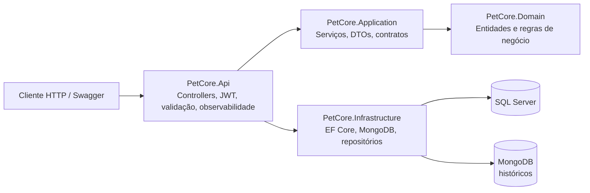

# 🐾 PetCore – Backend ASP.NET Core
## Challenger - 2026

## 🗣️ Dev do projeto
#### NOME: Emanuelly Ventura Do Nascimento

RM562339 - 2TDSPJ

#### NOME: Carolina Nascimento Gonçalves

RM564786 - 2TDSPJ

#### NOME: Julia Sayuri Kina

RM564555 - 2TDSPJ

## 📌 Descrição do Projeto

O **PetCore** é uma API REST desenvolvida em C# com ASP.NET Core para gerenciamento de informações veterinárias de pets, tutores, médicos, clínicas, prontuários, receitas, exames, medicamentos, históricos e relatórios.

O projeto foi organizado em camadas, separando responsabilidades entre API, Application, Domain e Infrastructure. A persistência relacional usa SQL Server com Entity Framework Core e migrations; históricos clínicos são persistidos no MongoDB por um repositório dedicado.


### Arquitetura



### Segurança e consultas

- `POST /api/auth/login` recebe `{ "email": "...", "password": "...", "role": "tutor" }` ou `role: "medico"`; credenciais inválidas retornam 401.
- Rotas dos controllers exigem JWT Bearer. Swagger inclui o botão **Authorize** para enviar o token.
- Consultas de coleção aceitam `page` (padrão 1), `pageSize` (padrão 20, máximo 100), `sortBy` (nome da propriedade da resposta) e `descending=true`.
- Filtros aceitam propriedades mapeadas da resposta; valores textuais usam busca parcial sem diferenciar maiúsculas/minúsculas e valores como datas, IDs, enums e booleanos usam comparação exata. As respostas de coleção contêm `items`, metadados de página e links `self`, `collection`, `previous` e `next`; consultas por ID incluem `self` e `collection`.
- Filtros, ordenação, contagem e paginação são aplicados nos repositórios antes de materializar os resultados: EF Core executa as consultas no SQL Server e MongoDB aplica filtro, ordenação e limites na consulta da coleção.
## Solução Proposta

A solução permite cadastrar e gerenciar os principais dados de uma clínica veterinária, oferecendo endpoints para criação, consulta, atualização e remoção de recursos.

O sistema contempla relacionamentos entre entidades, como:

- Tutor e Pet
- Pet e Histórico
- Histórico e Prontuário
- Prontuário, Exames e Receitas
- Receita e Medicamentos
- Médico e Prontuários, Exames, Receitas e Relatórios
- Clínica e Relatórios

## 🛠️ Funcionalidades

- Cadastro, listagem, busca, atualização e remoção de tutores
- Cadastro, listagem, busca, atualização e remoção de médicos
- Cadastro, listagem, busca, atualização e remoção de pets
- Cadastro e gerenciamento de clínicas
- Cadastro e gerenciamento de endereços
- Cadastro e gerenciamento de exames
- Cadastro e gerenciamento de prontuários
- Cadastro e gerenciamento de receitas
- Cadastro e gerenciamento de medicamentos
- Cadastro e gerenciamento de históricos
- Cadastro e gerenciamento de relatórios
- Login por email e senha para tutor
- Login por email e senha para médico
- Documentação via Swagger
- Migrations com Entity Framework Core

## 🛠️ Tecnologias Utilizadas

- C#
- ASP.NET Core
- Entity Framework Core
- Microsoft SQL Server
- MongoDB
- Microsoft.EntityFrameworkCore.SqlServer
- MongoDB.Driver
- Swagger / Swashbuckle
- Arquitetura em camadas
- Fluent API para mapeamento das entidades
- Serilog para logs estruturados
- OpenTelemetry e Prometheus para tracing e métricas
- xUnit, Moq e WebApplicationFactory para testes automatizados

## 📈 Monitoramento e Observabilidade

### Health checks

- `GET /health/live`: confirma que a API está em execução, sem dependências externas.
- `GET /health/ready`: valida a conectividade do SQL Server, MongoDB e do serviço externo configurado.

Os recursos gerais usam **SQL Server** via EF Core. O recurso `Historico` usa a coleção MongoDB `historicos`. Para verificar um serviço externo, informe a URL no campo `ExternalServices:BaseUrl` de `PetCore.Api/appsettings.json`.

### Compatibilidade com o aplicativo mobile

Os DTOs aceitam os campos do mobile (`nascimento`, `fotoUrl`, `genero`, `tutorId`, `comedouroStatus`, `dataConsulta`, `observacoes`, `tipoExame`, `arquivoSolicitacao`, `arquivoReceita`, `arquivoHistorico` e os dados de tutor/pet/veterinário). Os registros de prontuário, exame e receita guardam as referências de arquivos como texto; a API não faz upload de arquivos. Quando o mobile não envia vínculo clínico (`idMedico`, `idHistorico` ou `idProntuario`), os campos correspondentes podem ficar vazios no registro.

A migration inicial `InitialSqlServer` e as migrations seguintes estão em `PetCore.Infrastructure/Migrations`. As migrations PostgreSQL anteriores foram preservadas em `Migrations_PostgreSQL_Archive` como referência histórica. Aplique as migrations SQL Server com `dotnet ef database update --project PetCore.Infrastructure --startup-project PetCore.Api --context PetCoreContext`, usando a connection string `ConnectionStrings__DefaultConnection`.

### Logs, correlação e rastreabilidade

O Serilog escreve logs estruturados nos níveis Information, Warning e Error tanto no console como em `PetCore.Api/logs/`, com retenção de 14 dias. Toda requisição recebe/devolve o cabeçalho `X-Correlation-ID`; envie-o na chamada para correlacionar os eventos de ponta a ponta.

O OpenTelemetry instrumenta automaticamente as requisições ASP.NET Core e disponibiliza tracing distribuído entre as camadas. As métricas incluem duração de requisições e contador de erros HTTP 5xx, expostos em formato Prometheus em:

```text
GET /metrics
```

## ✅ Testes automatizados

Os testes estão organizados por responsabilidade e seguem o padrão **AAA** (Arrange, Act, Assert). A suíte tem 59 testes unitários e 5 de integração. Coverlet gera `PetCore.Tests.Unit/coverage.cobertura.xml` e falha o comando se qualquer uma das camadas Domínio ou Application ficar abaixo de 60% de cobertura de linhas. Última medição: Domínio 80,42%, Application 74,94% e total 76,70%.

- `PetCore.Tests.Unit`: testes de Domínio e Application com xUnit e Moq.
- `PetCore.Tests.Integration`: testes HTTP com `WebApplicationFactory`, `CollectionFixture` compartilhada e banco EF Core InMemory, sem exigir SQL Server ou MongoDB local.

Execute todos os testes na pasta raiz da solução (`PetCore.Net`):

```bash
dotnet test
```

A API usa JWT Bearer. O endpoint público `POST /api/auth/login` recebe `email`, `password` e `role` (`tutor` ou `medico`) e retorna `accessToken`; os controllers exigem `Authorization: Bearer <token>`. Senhas novas são armazenadas com hash PBKDF2; credenciais legadas são atualizadas para hash após um login válido. Os testes de integração cobrem login, proteção das rotas, paginação e HATEOAS.
## 📂 Estrutura do Projeto

```txt
PetCore
├── PetCore.Api
│   ├── Controllers
│   ├── Extensions
│   ├── Exceptions
│   └── Program.cs
│
├── PetCore.Application
│   ├── DTOs
│   ├── Interfaces
│   └── Services
│
├── PetCore.Domain
│   ├── Commons
│   ├── Entities
│   └── Enums
│
└── PetCore.Infrastructure
│   ├── Persistence
│   ├── Configurations
│   │   └── PetCoreContext.cs
│   ├── Repositories
│   └── Migrations
│
├── PetCore.Tests.Integration
│   ├── Api.Collection.cs
│   ├── HealthEndpointsTests.cs
│   └── PetCoreApiFactory.cs
│
└── PetCore.Infrastructure
│   ├── Application
│   │   └── ClinicaServiceTests.cs
│   ├── Domain
│   │   └── ClinicaTests.cs

```

## Documentação das Rotas

### Autenticação

POST /api/auth/login

Body JSON: `{ "email": "...", "password": "...", "role": "tutor" }` (ou `"medico"`). O endpoint retorna JWT Bearer. As rotas CRUD exigem token.

### Clínica

GET /api/Clinica?page=1&pageSize=20&sortBy=nome

GET /api/Clinica/{id}

POST /api/Clinica

PATCH /api/Clinica/{id} (compatibilidade: PUT /api/Clinica/{id}/patch)

DELETE /api/Clinica/{id}

---

### Endereço

GET /api/Endereco

GET /api/Endereco/{id}

POST /api/Endereco

PUT /api/Endereco/{id}/patch

DELETE /api/Endereco/{id}

---

### Exame

GET /api/Exame

GET /api/Exame/{id}

POST /api/Exame

PUT /api/Exame/{id}/patch

DELETE /api/Exame/{id}

---

### Histórico

GET /api/Historico

GET /api/Historico/{id}

POST /api/Historico

DELETE /api/Historico/{id}

---

### Medicamento

GET /api/Medicamento

GET /api/Medicamento/{id}

POST /api/Medicamento

PUT /api/Medicamento/{id}/patch

DELETE /api/Medicamento/{id}

---

### Médico

GET /api/Medico

GET /api/Medico/{id}


POST /api/Medico

PUT /api/Medico/{id}/patch

DELETE /api/Medico/{id}

---

## Pet

GET /api/Pet?page=1&pageSize=20&sortBy=nome

GET /api/Pet/menu?page=1&pageSize=20&sortBy=nome

GET /api/Pet/{id}

POST /api/Pet

PATCH /api/Pet/{id} (compatibilidade: PUT /api/Pet/{id}/patch)

DELETE /api/Pet/{id}

---

### Prontuário

GET /api/Prontuario

GET /api/Prontuario/{id}

POST /api/Prontuario

PUT /api/Prontuario/{id}/patch

DELETE /api/Prontuario/{id}

---

### Receita

GET /api/Receita

GET /api/Receita/{id}

POST /api/Receita

DELETE /api/Receita/{id}

---

### Relatório

GET /api/Relatorio

GET /api/Relatorio/{id}

POST /api/Relatorio

PUT /api/Relatorio/{id}/patch

DELETE /api/Relatorio/{id}

---

## Tutor

GET /api/Tutor?page=1&pageSize=20&sortBy=nome

GET /api/Tutor/{id}


POST /api/Tutor

PATCH /api/Tutor/{id} (compatibilidade: PUT /api/Tutor/{id}/patch)

DELETE /api/Tutor/{id}

---

## Protocolo

GET /api/Protocolo

GET /api/Protocolo/{id}

POST /api/Protocolo

PUT /api/Protocolo/{id}/patch

DELETE /api/Protocolo/{id}

---

## 🌐 Retornos HTTP

200 OK - Requisição realizada com sucesso

201 Created - Recurso criado com sucesso

204 NoContent - Recurso removido com sucesso

400 BadRequest - Dados inválidos enviados na requisição

404 NotFound - Recurso não encontrado

500 InternalServerError - Erro interno no servidor

--- 

## 🚀 Como Executar o Projeto

Siga os passos abaixo para configurar e executar a API PetCore localmente.

### 1. Pré-requisitos

Antes de iniciar, verifique se você possui instalado:

- .NET SDK
- SQL Server 2022 ou superior
- MongoDB ou Docker Desktop
- Visual Studio, Rider ou VS Code
- Ferramenta do Entity Framework Core

Para instalar/atualizar a ferramenta EF Core compatível com o projeto: `dotnet tool update --global dotnet-ef --version 10.0.5`.

Para verificar se o .NET está instalado:

```bash
dotnet --version

```

### 2. Acessar a Pasta Raiz da Solução

```bash
cd PetCore.Net
```

---

### 3. Restaurar os Pacotes

Na pasta raiz da solução, execute o comando abaixo para restaurar todas as dependências do projeto:

```bash
dotnet restore
```

---

### 4. Configurar os Bancos de Dados

No arquivo:

```bash
PetCore.Api/appsettings.json
```

Para desenvolvimento local, configure as conexões SQL Server e MongoDB nesse arquivo sem versionar credenciais. Em ambientes compartilhados, como o Render, use variáveis de ambiente conforme as instruções abaixo. Defina também `Jwt__Key` com um segredo aleatório de pelo menos 32 bytes, `Jwt__Issuer` e `Jwt__Audience`.

#### Configuração no Render (deploy Docker)

No painel do Render, abra o serviço Web da API e acesse **Environment**. Cadastre as variáveis abaixo em **Environment Variables**. Os valores são fornecidos pelo responsável pelo banco/ambiente; não os coloque no Dockerfile, no `appsettings.json` versionado ou em commits.

| Variável | Valor |
| --- | --- |
| `ConnectionStrings__DefaultConnection` | Connection string completa do SQL Server disponibilizada para o ambiente (Render) |
| `ConnectionStrings__MongoDb` | URI de conexão do MongoDB usado pela API |
| `Jwt__Key` | Segredo aleatório com pelo menos 32 bytes |
| `Jwt__Issuer` | Emissor configurado para o JWT (por exemplo, `PetCore`) |
| `Jwt__Audience` | Público configurado para o JWT (por exemplo, `PetCore.Client`) |

O ASP.NET Core converte `__` em `:` na configuração: `ConnectionStrings__DefaultConnection` corresponde a `ConnectionStrings:DefaultConnection`. Após salvar as variáveis, faça um novo deploy/restart do serviço. O Dockerfile apenas publica e inicia a aplicação; ele não define nem precisa conter as credenciais do banco. A API encerra a inicialização com uma mensagem clara se `ConnectionStrings__DefaultConnection`, `ConnectionStrings__MongoDb` ou `Jwt__Key` não estiver configurada.

#### SQL Server:

Defina `ConnectionStrings__DefaultConnection` (exemplo PowerShell):

```powershell
$env:ConnectionStrings__DefaultConnection = "Server=localhost;Database=PetCore;User Id=sa;Password=<senha-forte>;TrustServerCertificate=True;MultipleActiveResultSets=true"
$rng = [System.Security.Cryptography.RandomNumberGenerator]::Create()
$bytes = New-Object byte[] 48
$rng.GetBytes($bytes)
$env:Jwt__Key = [Convert]::ToBase64String($bytes)
$rng.Dispose()
$env:Jwt__Issuer = "PetCore"
$env:Jwt__Audience = "PetCore.Client"
```

#### MongoDB local (Docker Desktop):

```json
{
  "ConnectionStrings": {
    "MongoDb": "mongodb://localhost:27017"
  }
}
```

---

### 5. Aplicar as Migrations

Com o SQL Server em execução e a connection string definida, aplique as migrations para criar as tabelas do banco de dados:

```bash
dotnet ef database update --project PetCore.Infrastructure --startup-project PetCore.Api --context PetCoreContext
```

#### Alternativa com Script SQL

Script SQL Server idempotente gerado a partir da migration:

```bash
PetCore.Infrastructure/Migrations/InitialSqlServer.sql
```

O script idempotente foi gerado para SQL Server. Conforme informado, as migrations foram aplicadas ao banco de produção hospedado no Render. Para novos ambientes, configure a connection string por variável de ambiente antes de aplicar as migrations.

Para iniciar somente o MongoDB local com o Docker Desktop, execute:

```bash
docker run -d --name petcore-mongodb -p 27017:27017 -v petcore-mongo-data:/data/db mongo:8
```

O MongoDB cria o banco `petcore` e a coleção `historicos` na primeira gravação. A API conecta usando `ConnectionStrings:MongoDb` e permite substituir a URI com `ConnectionStrings__MongoDb`.

---

### 6. Compilar o Projeto

Compile a solução para verificar se tudo está funcionando corretamente:

```bash
dotnet build
```

---

### 7. Executar a API

Execute a aplicação com o comando:

```bash
dotnet run --project PetCore.Api
```

---

### 8. Acessar o Swagger

Após iniciar a aplicação, o terminal exibirá a porta em que a API está rodando.

Acesse a documentação Swagger pelo navegador:

```bash
https://localhost:<porta>/swagger
```

ou

```bash
http://localhost:<porta>/swagger
```

#### Exemplo:

```bash
https://localhost:5001/swagger

```
---

# 🚀Link do Deploy
https://petcore-net.onrender.com


---


